  <a href="https://ali-aljawad.netlify.app">
    <picture>
      <source media="(prefers-color-scheme: dark)" srcset="./assets/id-card-dark.svg">
      <source media="(prefers-color-scheme: light)" srcset="./assets/id-card-light.svg">
      
    </picture>
  </a>

  <a href="https://ali-aljawad.netlify.app">Portfolio</a>&nbsp;&nbsp;·&nbsp;&nbsp;
  <a href="https://docs.google.com/document/d/1CYqxwTHFCvbFWA-jLX2nOEOstl5zbtHH/edit?usp=sharing&ouid=113671419507753801897&rtpof=true&sd=true">CV</a>&nbsp;&nbsp;·&nbsp;&nbsp;
  <a href="https://linkedin.com/in/ali-aljawad-4a212718a">LinkedIn</a>&nbsp;&nbsp;·&nbsp;&nbsp;
  <a href="mailto:alialjawad2k1@gmail.com">alialjawad2k1@gmail.com</a>

 

  <picture>
    <source media="(prefers-color-scheme: dark)" srcset="https://skillicons.dev/icons?i=nextjs,ts,react,nodejs,js,html,css,laravel,php,mysql,mongodb,python,cs,dotnet,java,aws,linux,git,postman,figma,arduino&perline=7&theme=dark">
    
  </picture>

  

